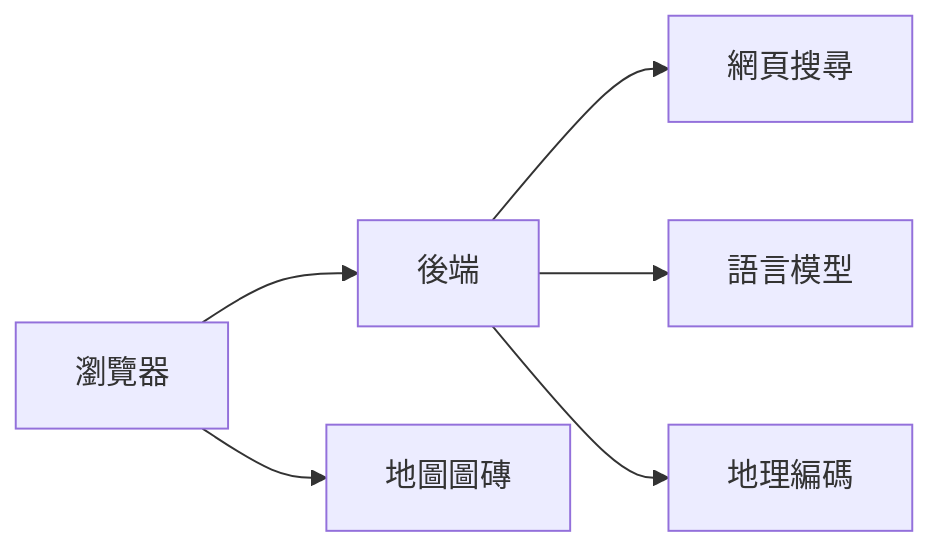

# 旅遊行程管理系統：第一版系統開發規格書

## 1. 文件目的

本文件定義「旅遊行程管理系統」第一版要做什麼、畫面長什麼樣子、清單如何產生、以及怎樣算做完。後續實作依本文件為準。

第一版只處理一件事：依多個目的地與旅遊天數，搜尋網路後整理出景點清單與美食清單，讓你勾選要留下的項目，再把留下的項目標到地圖上。

## 2. 專題概述

| 項目 | 內容 |
| --- | --- |
| 專題名稱 | 旅遊行程管理系統 |
| 使用者 | 你本人，用來規劃自己的旅行 |
| 要完成的事 | 排好一次旅行要去的景點與美食，並在地圖上看到它們的位置 |
| 第一版做法 | 系統搜尋網路，再由 AI 只根據搜尋結果整理成兩張清單 |

你目前規劃旅行的做法，是先看部落格或社群蒐集景點，再自己整理細節，並用地圖排列。第一版取代其中最花時間的蒐集與整理：不必先讀很多篇介紹，就能得到一份跨多個目的地、已勾選、標在地圖上的清單。

## 3. 使用者與使用情境

系統供你一人使用。打開網頁即可開始，第一版沒有帳號，也沒有登入。

使用情境：你已決定要去哪些地方、大概幾天，還沒決定每天去哪。例如目的地依序為金澤、富山、高山、加賀。你希望系統直接給出可勾選的景點與美食，每一列都說明為什麼適合這趟、營業時間、要不要預約，並附上可以打開的資料來源。

瀏覽器只保留目前這一趟的條件、清單與勾選。重新整理頁面後，這一趟仍在。重新產生清單時，以新結果取代舊清單，並清空勾選。

## 4. 現況步驟與第一版對應

| 現況步驟 | 第一版 |
| --- | --- |
| 1. 看部落格或社群蒐集景點 | 本版處理。改由系統搜尋並整理 |
| 2. 整理景點細節 | 本版一併處理清單欄位：為什麼適合、營業時間、要不要預約、資料來源 |
| 3. 用地圖排列 | 本版處理已勾選項目的標點。排列成每日路線留待後續版本 |
| 4. 決定每個景點的停留時間 | 後續版本 |
| 5. 看地圖找附近住宿 | 後續版本 |
| 6. 整理交通運輸方式 | 後續版本。車次與預訂不在本版 |
| 7. 整理大約需要的費用 | 後續版本 |

## 5. 第一版範圍

### 5.1 第一版包含

1. 依多個目的地與旅遊天數，產生景點清單與美食清單。
2. 在清單上勾選要留下的景點與美食。
3. 把已勾選的景點與美食標在同一張地圖上。

### 5.2 後續版本再做

- 交通方式、車次與交通預訂
- 住宿搜尋與住宿標記
- 費用整理
- 每日時程、停留時間與路線順序
- 代為預約或訂位
- 多人共用與帳號

驗收時只檢查第 5.1 節的三項。後續版本的項目不出現在第一版畫面，也不出現在清單欄位中。

## 6. 成功標準

第一版成功，是指你可以不用自己讀很多篇介紹，就得到一份符合下列條件的結果：

1. 涵蓋你輸入的全數目的地。
2. 景點與美食都已由你勾選過。
3. 每一列都有為什麼適合、營業時間、要不要預約、資料來源。
4. 留下的項目標在地圖上。

第 14 節把這四點對回畫面與功能，作為驗收檢查項。營業時間或預約若在搜尋摘要中沒有寫到，該欄顯示「來源未記載」，這一列仍然算完整。

## 7. 使用流程

1. 你在輸入頁填入依旅行順序排列的目的地與總天數。各目的地天數可留空。
2. 按下產生前，系統顯示每個目的地分到幾天。你確認天數後，系統才開始搜尋。
3. 系統對每個有天數的目的地搜尋景點與美食，並整理成兩張清單。
4. 你在景點分頁與美食分頁勾選要留下的項目。
5. 確認頁列出已選項目，地圖只標這些項目。

清單頁與確認頁都可以回到輸入頁修改條件。重新產生會取代這一趟的清單與勾選。

## 8. 畫面規格

第一版有三個畫面。勾選做在清單畫面上，不另開一頁。介面文字使用繁體中文。

### 8.1 畫面一：輸入條件

| 欄位 | 規則 |
| --- | --- |
| 旅行名稱 | 可空白。有填時，顯示在清單頁與確認頁 |
| 目的地 | 至少一筆。可新增、刪除、調整順序。順序就是旅行順序。例：金澤、富山、高山、加賀 |
| 總天數 | 必填，正整數 |
| 各目的地天數 | 可全部留空。若要自行分配，每一個目的地都要填非負整數，加總必須等於總天數 |

按下「產生景點與美食清單」時：

- 目的地少於一筆，或總天數不是正整數：停在本頁，指出要修正的欄位。
- 各目的地天數全部留空：依第 11.1 節分配天數，把結果顯示在本頁。你確認後才開始搜尋；你也可以改數字，改完後的加總仍須等於總天數。
- 只填了部分目的地的天數：停在本頁，要求每個目的地都填天數，或全部清空改由系統分配。
- 已填天數的加總與總天數不同：停在本頁，指出加總必須等於總天數。

搜尋進行中，本頁顯示目前正在處理哪一個目的地，以及正在搜尋景點或美食。搜尋結束後進入清單頁。

### 8.2 畫面二：清單

清單頁有兩個分頁：「景點」與「美食」。項目依目的地分組，組的順序與旅行順序相同。每一列預設不勾選。分頁上顯示該分頁已勾選的數量。

景點分頁每一列的欄位：

| 欄位 | 內容 |
| --- | --- |
| 勾選 | 留下這個景點 |
| 目的地 | 所屬目的地 |
| 名稱 | 景點名稱 |
| 為什麼適合 | 對應該目的地與這趟天數的短文，讀完即可決定要不要留下 |
| 景點營業時間 | 來源摘要中的營業時間文字；摘要沒寫則為「來源未記載」 |
| 要不要預約 | 「需要」、「不需要」或「來源未記載」 |
| 資料來源 | 一筆以上的來源，每筆含標題與可開啟的連結 |
| 擷取日期 | 這次搜尋的日期 |

美食分頁使用相同欄位，營業時間欄名為「美食營業時間」。

某一目的地沒有搜尋到合格項目時，該組顯示「查無資料」，其他目的地的項目照常列出。分配到 0 天的目的地仍出現在順序中，並顯示「這段未分配天數，沒有候選」。

### 8.3 畫面三：確認

確認頁分為已選清單與地圖。

已選清單只含兩個分頁中勾選的項目，並依目的地分組。每一項標明是景點或美食，並顯示名稱、營業時間、要不要預約、資料來源。

地圖只標已勾選項目。景點與美食使用兩種不同標記。點標記可看名稱、營業時間、要不要預約、資料來源。地圖使用 Leaflet，圖磚使用 OpenStreetMap。

座標對不到的已選項目留在已選清單，並標示「未能標上地圖」，地圖上不為它放標記。

尚未勾選任何項目時，已選清單顯示「尚未勾選景點或美食」，地圖上沒有標記，並可回到清單頁。

## 9. 功能需求

### FR-1 輸入條件與天數分配

系統接受依旅行順序排列的多個目的地、總天數，以及可選的各目的地天數。天數規則與錯誤提示依第 8.1 節。未手動分配時，系統先顯示分配結果，經你確認後才產生清單。

### FR-2 產生景點清單與美食清單

系統對每個分配到至少一天的目的地，分別產生景點候選與美食候選。產生步驟依第 11 節。兩張清單在同一次產生中一起完成。每一列都有第 8.2 節的欄位，且至少有一個來自這次搜尋結果的連結。

### FR-3 勾選要留下的項目

你可以在景點分頁與美食分頁分別勾選或取消。勾選狀態寫入瀏覽器。重新整理後，勾選仍在。重新產生清單後，勾選清空。

### FR-4 把已選項目標在地圖上

確認頁讀取目前勾選的景點與美食。有座標的項目出現在地圖上，景點與美食標記不同。沒有座標的項目留在清單並標示「未能標上地圖」。取消勾選後回到確認頁時，該項目從地圖與已選清單消失。

## 10. 資料欄位

一筆候選項目含下列資料。景點與美食結構相同，以類型區分。

| 欄位 | 說明 |
| --- | --- |
| id | 這次產生中的唯一識別，供勾選儲存使用 |
| type | 「景點」或「美食」 |
| destination | 目的地名稱 |
| name | 項目名稱 |
| whyFit | 為什麼適合。兩到四句，內容對應這個目的地與分配到的天數，並能在來源摘要中找到依據 |
| hours | 營業時間原文，或「來源未記載」 |
| reservation | 「需要」、「不需要」或「來源未記載」 |
| sources | 一筆以上。每筆含 title 與 url |
| retrievedAt | 擷取日期，格式 YYYY-MM-DD。同一次產生的所有項目使用同一個日期 |
| lat, lng | 座標。對不到時為空 |
| geocodeStatus | 「已標點」或「未能標上地圖」 |

瀏覽器保存的這一趟包含：旅行名稱、目的地與天數、產生結果、已勾選的 id。

## 11. 清單產生規則

### 11.1 天數分配

目的地依輸入順序為第 1 個到第 n 個，總天數為 T。各目的地天數全部留空時：

- 基本天數 = T 除以 n 的商（無條件捨去）
- 餘數 = T 除以 n 的餘數
- 前「餘數」個目的地各得基本天數加 1 天
- 其餘目的地各得基本天數

例：金澤、富山、高山、加賀共 7 天，分配為 2、2、2、1 天。若總天數少於目的地數，排序較後的目的地可以是 0 天。

### 11.2 候選數量

某目的地分配到 d 天，且 d 大於或等於 1 時：

- 景點目標數量 = 每天 3 個，且該目的地最多 8 個。亦即取 3 乘以 d 與 8 的較小值
- 美食目標數量 = 每天 2 個，且該目的地最多 6 個。亦即取 2 乘以 d 與 6 的較小值

沿用上一例：7 天分配為 2、2、2、1 時，景點目標依序為 6、6、6、3 個，美食目標依序為 4、4、4、2 個。

搜尋結果不足以達到目標時，列出實際找到的合格項目，不足的部分留空，不補上沒有來源的項目。合格項目多於目標時，依第 11.3 節的來源順序取到目標數量為止。

d 為 0 的目的地不搜尋、不產生候選。

### 11.3 搜尋與整理的六個步驟

對每個 d 大於或等於 1 的目的地，景點與美食各做一次下列流程。

1. **組查詢。** 每個目的地至少送出中文查詢，以及該地主要使用語言的查詢。景點與美食分開查。日本目的地的當地語言為日文。例：金澤的景點查詢同時包含「金澤 景點」與「金澤 観光」；美食查詢同時包含「金澤 美食」與「金澤 グルメ」。
2. **取回結果。** 每筆搜尋結果保留標題、摘要、網址。第一版以這三項作為整理依據，不另抓整頁內文。
3. **排來源順序。** 官方觀光單位或該場所自己的網站排在前面，其次是摘要中寫得出營業時間或預約規定的介紹頁。只有綜合介紹時，仍可採用該介紹的網址。
4. **整理欄位。** 語言模型只根據本次取回的標題、摘要、網址，輸出第 10 節的欄位。為什麼適合、營業時間、預約狀態都必須能對回某一筆取回的摘要。摘要沒有寫營業時間，hours 為「來源未記載」。摘要沒有寫要不要預約，reservation 為「來源未記載」。
5. **只留下有真實連結的項目。** 來源網址必須出現在這次搜尋取回的結果中。沒有網址、或網址不在取回結果裡的項目捨棄。同一目的地、同一類型、名稱相同的項目合併成一列，來源並列。
6. **標上擷取日期。** 所有留下的項目寫入這次搜尋的日期。

地理編碼使用「項目名稱加上目的地」查詢座標，與語言模型整理分開進行。對到座標則 geocodeStatus 為「已標點」。對不到則座標為空，geocodeStatus 為「未能標上地圖」，該項目仍留在清單。

## 12. 系統架構

| 部分 | 責任 |
| --- | --- |
| 瀏覽器 | 三個畫面、勾選、Leaflet 地圖。圖磚來自 OpenStreetMap。目前這一趟存在瀏覽器 |
| 後端 | 保管網頁搜尋與語言模型的金鑰，執行第 11.3 節，回傳兩張清單與座標狀態 |
| 網頁搜尋 | 依查詢回傳標題、摘要、網址 |
| 語言模型 | 把取回內容整理成固定欄位 |
| 地理編碼 | 把名稱與目的地轉成座標 |
| 地圖圖磚 | 供瀏覽器顯示底圖。第一版使用 OpenStreetMap |

瀏覽器只呼叫自己的後端。搜尋金鑰與模型金鑰放在後端。地圖在瀏覽器以 Leaflet 顯示，圖磚為 OpenStreetMap。

後端產生清單時，請求至少包含旅行名稱、目的地順序、各目的地天數與總天數。回應至少包含擷取日期，以及每個目的地下的景點陣列、美食陣列，和該組是成功、查無資料或搜尋失敗。

## 13. 例外情況

| 情況 | 系統行為 |
| --- | --- |
| 某目的地的景點或美食搜尋失敗 | 該組顯示搜尋失敗，並可只重試該組。已成功的其他目的地照常顯示。失敗組不產生沒有來源的項目 |
| 某目的地沒有合格結果 | 該組顯示「查無資料」 |
| 摘要沒有營業時間或預約資訊 | 該欄顯示「來源未記載」 |
| 地理編碼失敗 | 項目留在清單，確認頁標示「未能標上地圖」 |
| 尚未勾選就打開確認頁 | 顯示「尚未勾選景點或美食」，地圖沒有標記 |
| 重新產生 | 以新清單取代舊清單，勾選清空 |

第一版的營業時間與預約只填入搜尋摘要中看得到的記載。摘要未記載時，該欄為「來源未記載」，你可打開資料來源自行核對。

## 14. 驗收

驗收使用一組含多個目的地的輸入，例如金澤、富山、高山、加賀，並給定總天數。下列每一項都要通過。

| 編號 | 成功標準 | 檢查方式 | 對應 |
| --- | --- | --- | --- |
| A1 | 一次得到跨全數目的地的景點清單與美食清單 | 確認天數後只按一次產生。清單頁兩個分頁都有各目的地的分組；沒有結果的組顯示「查無資料」或「這段未分配天數，沒有候選」 | 畫面一、畫面二、FR-1、FR-2 |
| A2 | 每一列都能用來決定去不去，且不必先讀原文 | 每一列都有為什麼適合、營業時間或「來源未記載」、預約狀態、至少一個可開啟的來源連結、擷取日期。為什麼適合對得到該列來源摘要 | 畫面二、第 10 節、第 11.3 節 |
| A3 | 景點與美食都經過勾選 | 兩分頁預設都未勾選。勾選後分頁數量增加；取消後減少。重新整理後勾選仍在 | 畫面二、FR-3 |
| A4 | 留下的項目標在地圖上 | 確認頁的地圖只出現已勾選的景點與美食，兩種標記不同。點標記可看名稱、時間、預約、來源。取消勾選的項目不在地圖上。對不到座標的已選項標示「未能標上地圖」 | 畫面三、FR-4 |
| A5 | 來源是這次搜尋到的實際連結 | 抽查清單中的連結，網址可開啟，且屬於該次搜尋取回的結果。沒有來源的列不存在 | 第 11.3 節步驟 5 |
| A6 | 第一版停在蒐集、勾選與標點 | 三個畫面與清單欄位中，沒有交通、車次、預訂、住宿、費用、每日時程、停留時間、代為預約 | 第 5.2 節 |

A1 到 A4 對應第 6 節的成功標準。A5 確認清單來自搜尋結果。A6 確認交通與其他後續項目沒有進入第一版。
